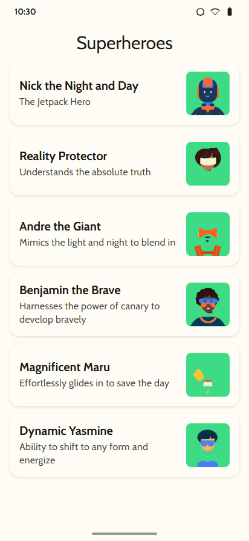
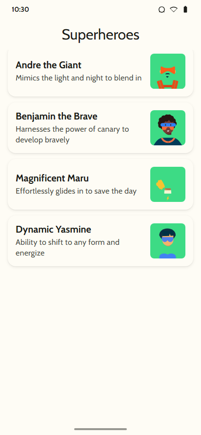
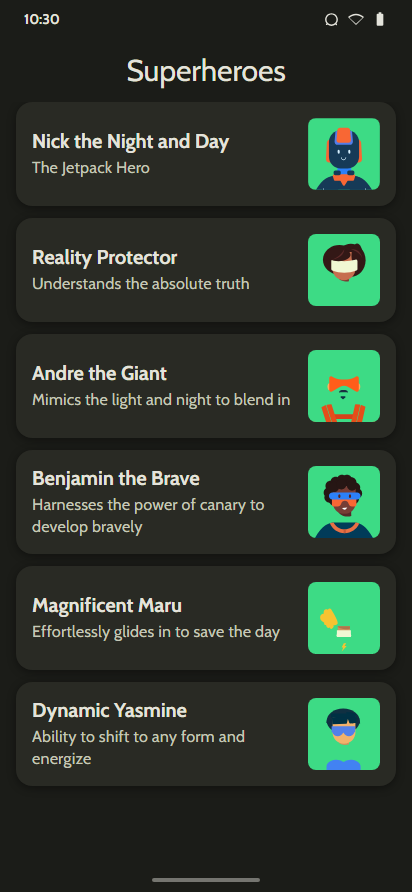
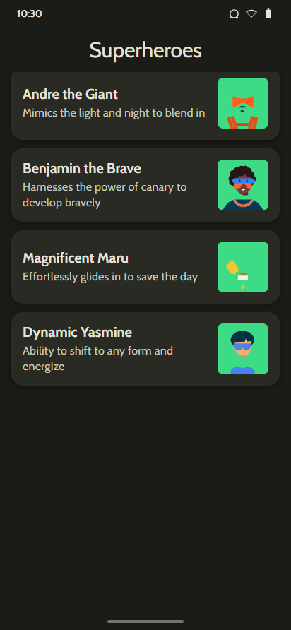
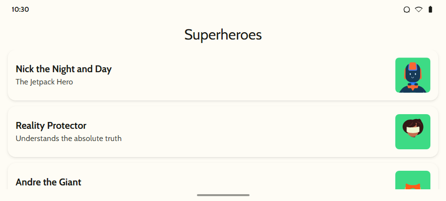

# Superheroes App 🦸‍♂️🦸‍♀️

Aplicación para Android desarrollada con **Jetpack Compose** y **Material Design 3**, siguiendo la práctica del codelab oficial de Android Developers:
[Practice: Build Superheroes app](https://developer.android.com/codelabs/basic-android-kotlin-compose-practice-superheroes).

---

## 📱 Características

- **Material Theming 3:**
  - Paleta de colores completa para modo claro y modo oscuro.
  - Tipografía personalizada con la familia de fuentes **Cabin** (Regular y Bold).
  - Formas de bordes redondeados (`Shapes`) aplicadas a tarjetas e imágenes.
- **Lista con Scroll Optimizado:**
  - Implementación con `LazyColumn` para una carga eficiente de elementos.
  - Diseño de tarjetas (`Card`) con elevación, distribución horizontal y recorte de imágenes (`clip`).
- **Animaciones Fluidas con Compose:**
  - Animación de entrada con desvanecimiento (`fadeIn`) y efecto de resorte (`spring`).
  - Animación escalonada vertical para cada elemento de la lista (`slideInVertically` con `animateEnterExit`).
- **Barra Superior (TopAppBar):**
  - `CenterAlignedTopAppBar` con el título estilizado de la aplicación.
  - Soporte de pantalla completa (`enableEdgeToEdge()`).
- **Vistas Previas:**
  - Previews en modo claro y oscuro (`@Preview`).

---

## 📸 Capturas de Pantalla

| Modo Claro (Inicio) | Modo Claro (Scroll) | Modo Oscuro (Inicio) | Modo Oscuro (Scroll) |
|:---:|:---:|:---:|:---:|
|  |  |  |  |

### Vista Horizontal (Landscape)

---

## 🛠️ Tecnologías y Requisitos

- **Kotlin** 2.1.0
- **Jetpack Compose** (Compose BOM 2024.11.00)
- **Material 3**
- **Android SDK:**
  - Min SDK: 24 (Android 7.0)
  - Target/Compile SDK: 35
- **JDK:** Java 17 o superior
- **Gradle:** 8.11.1

---

## 🚀 Cómo ejecutar el proyecto

1. Abre **Android Studio** (versión Ladybug o superior recomendada).
2. Selecciona **Open** y navega hasta el directorio del proyecto.
3. Permite que Gradle sincronice las dependencias.
4. Ejecuta la aplicación en un emulador o dispositivo físico con Android 7.0 o superior.
